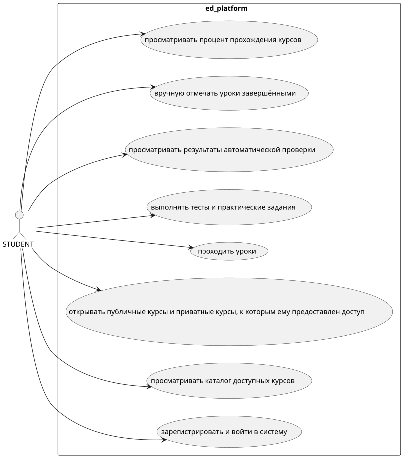
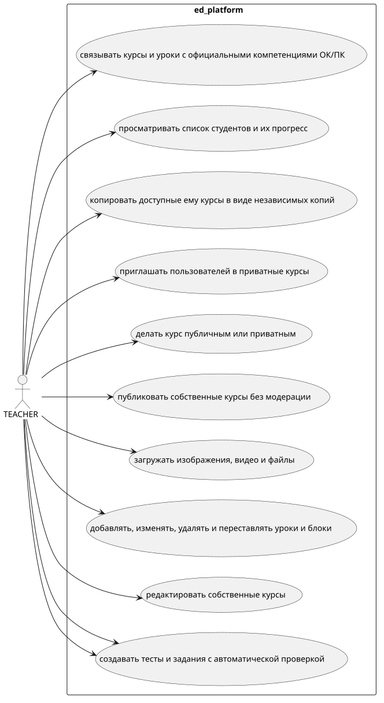
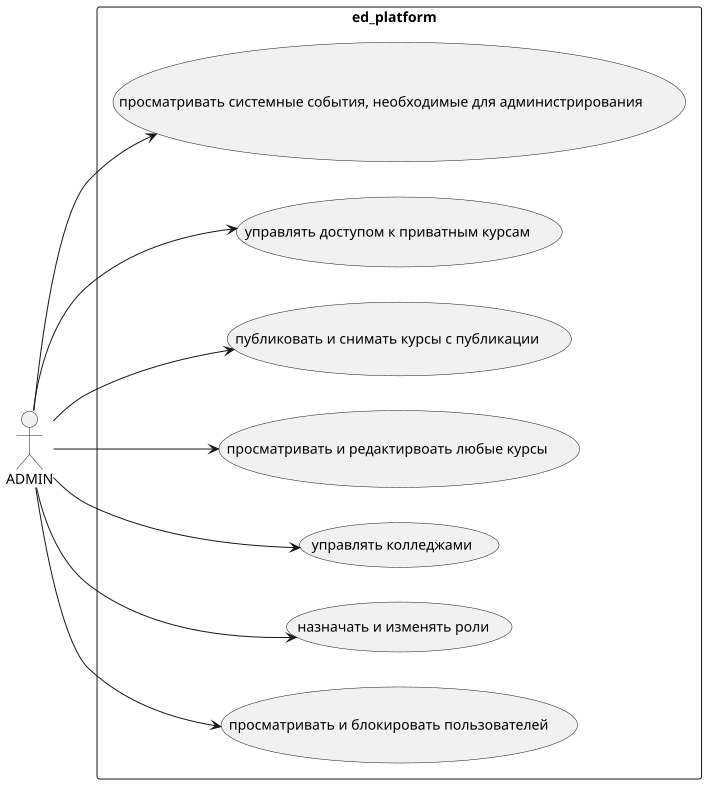

# Техническое задание

## Образовательная платформа для изучения IT-дисциплин

# 1. Общие сведения

## 1.1 Назначение системы

Разрабатываемая платформа представляет собой веб-платформу для создания, публикации и самостоятельного прохождения интерактивных образовательных курсов по IT-дисциплинам.

Платформа предназначена для использования в колледжах. Первая версия будет внедряться в одном колледже, однако архитектура должна предусматривать возможность подключения дополнительных образовательных организаций.

Главная идея платформы - объединить учебные материалы и практические задания в едином интерфейсе. Студент должен иметь возможность изучать теорию, просматривать видео, работать с примерами и выполнять задания, не покидая урок.

## 1.2 Основные цели

1. Предоставить преподавателям визуальный конструктор учебных курсов.
2. Обеспечить студентам самостоятельное обучения в удобном темпе.
3. Объединить теорию, мультимедийные материалы и практические задания.
4. Автоматизировать проверку поддерживаемых типов заданий.
5. Сохранять прогресс обучения.
6. Обеспечить разграничение прав доступа.
7. Подготовить архитектуру для масштабирования на несколько колледжей.

## 1.3 Границы первой версии

В первую версию входят регистрация, авторизация, каталог курсов, конструктор уроков, загрузка материалов, тесты, автоматическая проверка ответов, прогресс обучения и администрирование управление.

Исполнение произвольного пользовательского кода, OAuth, интеграция с ИИ и расширенная аналитика не входят в обязательный объем MVP.

# 2. Пользователи и роли

В системе предусмотрены 3 роли.

| Роль | Описание |
|---|---|
| `STUDENT` | Изучает курсы, выполняет задания, отслеживает свой прогресс. |
| `TEACHER` | Создает, редактирует и публикует собственные курсы, просматривает прогресс студентов своих курсов. |
| `PLATFORM_ADMIN` | Управляет пользователями, ролями, колледжами и всеми курсами платформы. |

## 2.1 Студент

Студент должен иметь возможность:

## 2.2 Преподаватель

Преподаватель должен иметь возможность:

## 2.3 Администратор платформы

Администратор должен иметь возможность:

Публичная регистрация не должна позволять пользователю самостоятельно назначить себе роль преподавателя или администратора.

# 3. Функциональные требования

## 3.1 Регистрация и авторизация

**Обязательно для MVP:**

- Регистрация по email и паролю;
- Вход и выход из аккаунта;
- Проверка корректности email и уникальности аккаунта;
- Хранение паролей только в виде криптографического хэша с использованием BCrypt через Spring Security;
- Получение данных текущего пользователя;
- Ограничение доступа к функциям в соответствии с ролью;
- Защита административных операций от неавторизованных пользователей.

Подтверждение email, восстановление пароля и способ доставки писем необходимо согласовать до запуска пилота. OAuth через Google и Яндекс переносится на следующий этап.

Документация: [Spring Security - Password Storage](https://docs.spring.io/spring-security/reference/features/authentication/password-storage.html?utm_source=chatgpt.com).

## 3.2 Каталог курсов

Каталог должен отображать:

- название курса;
- описание;
- обложку;
- имя автора;
- дисциплину;
- статус публикации, если пользователь имеет право его видеть.

Пользователь должен иметь возможность открыть страницу курса и ознакомиться с его описанием.

Предусматриваются 2 типа доступа:

- **Публичный курс** - доступен всем пользователям согласно общим правилам платформы.
- **Приватный курс** - доступен только приглашённым пользователем и администратором соответствующими правами.

## 3.3 Управление курсами

Преподаватель может создавать курсы, редактировать их и публиковать без модерации.

Предусматриваются состояния курса:

- `DRAFT` - черновик;
- `PUBLISHED` - опубликован;
- `ARCHIVED` - архивирован;

При копировании курса создается независимый копия с новым идентификатором и новым автором-копией. Изменение оригинала не должны автоматически изменять копию. Удаление курса, которые уже проходили студенты, следует ограничить или заменить архивированием, чтобы не терять историю обучения.

# 4. Конструктор курсов и структура уроков

## 4.1 Структура

Основная структура:

`Курс -> Уроки -> Последовательные шаги`

Модуль в MVP необязательны. В дальнейшем их можно добавить для группировки уроков.

## 4.2 Визуальный конструктор

Преподаватель должен иметь возможность:

- добавлять блоки в урок;
- редактировать содержимое блоков;
- менять порядок блоков;
- удалять блоки;
- сохранять черновик;
- просматривать предварительный результат;
- публиковать курс.

Конструктор должен быть визуальным. Преподавателю не нужно самостоятельно писать HTML или React для форматирования обычных учебных материалов.

## 4.3 Поддерживаемые блоки

|||
|---|---|
|||
|||
|||
|||
|||
|||
|||
|||
|||
