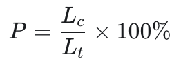

# Техническое задание

## Образовательная платформа для изучения IT-дисциплин

# 1. Общие сведения

## 1.1 Назначение системы

Разрабатываемая платформа представляет собой веб-платформу для создания, публикации и самостоятельного прохождения интерактивных образовательных курсов по IT-дисциплинам.

Платформа предназначена для использования в колледжах. Первая версия будет внедряться в одном колледже, однако архитектура должна предусматривать возможность подключения дополнительных образовательных организаций.

Главная идея платформы - объединить учебные материалы и практические задания в едином интерфейсе. Студент должен иметь возможность изучать теорию, просматривать видео, работать с примерами и выполнять задания, не покидая урок.

## 1.2 Основные цели

1. Предоставить преподавателям визуальный конструктор учебных курсов.
2. Обеспечить студентам самостоятельное обучения в удобном темпе.
3. Объединить теорию, мультимедийные материалы и практические задания.
4. Автоматизировать проверку поддерживаемых типов заданий.
5. Сохранять прогресс обучения.
6. Обеспечить разграничение прав доступа.
7. Подготовить архитектуру для масштабирования на несколько колледжей.

## 1.3 Границы первой версии

В первую версию входят регистрация, авторизация, каталог курсов, конструктор уроков, загрузка материалов, тесты, автоматическая проверка ответов, прогресс обучения и администрирование управление.

Исполнение произвольного пользовательского кода, OAuth, интеграция с ИИ и расширенная аналитика не входят в обязательный объем MVP.

# 2. Пользователи и роли

В системе предусмотрены 3 роли.

| Роль | Описание |
|---|---|
| `STUDENT` | Изучает курсы, выполняет задания, отслеживает свой прогресс. |
| `TEACHER` | Создает, редактирует и публикует собственные курсы, просматривает прогресс студентов своих курсов. |
| `PLATFORM_ADMIN` | Управляет пользователями, ролями, колледжами и всеми курсами платформы. |

## 2.1 Студент

Студент должен иметь возможность:


## 2.2 Преподаватель

Преподаватель должен иметь возможность:


## 2.3 Администратор платформы

Администратор должен иметь возможность:


Публичная регистрация не должна позволять пользователю самостоятельно назначить себе роль преподавателя или администратора.

# 3. Функциональные требования

## 3.1 Регистрация и авторизация

**Обязательно для MVP:**

- Регистрация по email и паролю;
- Вход и выход из аккаунта;
- Проверка корректности email и уникальности аккаунта;
- Хранение паролей только в виде криптографического хэша с использованием BCrypt через Spring Security;
- Получение данных текущего пользователя;
- Ограничение доступа к функциям в соответствии с ролью;
- Защита административных операций от неавторизованных пользователей.

Подтверждение email, восстановление пароля и способ доставки писем необходимо согласовать до запуска пилота. OAuth через Google и Яндекс переносится на следующий этап.

Документация: [Spring Security - Password Storage](https://docs.spring.io/spring-security/reference/features/authentication/password-storage.html?utm_source=chatgpt.com).

## 3.2 Каталог курсов

Каталог должен отображать:

- название курса;
- описание;
- обложку;
- имя автора;
- дисциплину;
- статус публикации, если пользователь имеет право его видеть.

Пользователь должен иметь возможность открыть страницу курса и ознакомиться с его описанием.

Предусматриваются 2 типа доступа:

- **Публичный курс** - доступен всем пользователям согласно общим правилам платформы.
- **Приватный курс** - доступен только приглашённым пользователем и администратором соответствующими правами.

## 3.3 Управление курсами

Преподаватель может создавать курсы, редактировать их и публиковать без модерации.

Предусматриваются состояния курса:

- `DRAFT` - черновик;
- `PUBLISHED` - опубликован;
- `ARCHIVED` - архивирован;

При копировании курса создается независимый копия с новым идентификатором и новым автором-копией. Изменение оригинала не должны автоматически изменять копию. Удаление курса, которые уже проходили студенты, следует ограничить или заменить архивированием, чтобы не терять историю обучения.

# 4. Конструктор курсов и структура уроков

## 4.1 Структура

Основная структура:

`Курс -> Уроки -> Последовательные шаги`

Модуль в MVP необязательны. В дальнейшем их можно добавить для группировки уроков.

## 4.2 Визуальный конструктор

Преподаватель должен иметь возможность:

- добавлять блоки в урок;
- редактировать содержимое блоков;
- менять порядок блоков;
- удалять блоки;
- сохранять черновик;
- просматривать предварительный результат;
- публиковать курс.

Конструктор должен быть визуальным. Преподавателю не нужно самостоятельно писать HTML или React для форматирования обычных учебных материалов.

## 4.3 Поддерживаемые блоки

| Тип блока | Требования |
|---|---|
| Текст | Заголовки, абзацы, списки, выделение текста |
| Пример кода | Форматированное отображение исходного кода без исполнения |
| Практическое задание | Условие, форма ответа, результат проверки |
| Тест | Вопросы с вариантами ответов |
| Изображение или схема | Отображение непосредственно в уроке |
| Видео | Встроенный плеер внутри урока |
| Файл | Просмотр информации о файле и скачивание |
| Предупреждение | Визуально выделенный информационный блок |
| Внешний материал| Дополнительная ссылка на учебный ресурс |

Содержимое блоков должно храниться в структурированном виде. Нельзя без проверки выводить введённый преподавателем произвольной HTML: это создает риск XSS-атак.

## 4.4 Прохождение урока

Урок отображается как последовательность шагов. Студент переходит от одного шага к следующему.

В MVP не требуется принудительно блокировать после последующего уроки до завершения предыдущих. Студент проходит курс в собственном темпе.

Завершению урока выполняется вручную нажатием кнопки "Завершить урок".

# 5. Практические задания и автоматическая проверка

## 5.1 Поддерживаемые типы заданий

В MVP необходимо реализовать:

1. Тест с одним правильным ответом.
2. Тест с несколькими правильными ответами – если позволяет срок.
3. Короткий текстовый ответ с автоматическим сравнением.
4. Практическое задание с проверкой ответа по заранее определённым правилам.

## 5.2 Поведение системы

При отправке ответа система должна:

1. Проверить, имеет ли пользователь доступ к заданию.
2. Проверить форматы допустимой размер ответа.
3. Выполнить проверку по правилам задания.
4. Вернуть результат студенту.
5. Сохранить попытку результат в БД.

Правильные ответы и критерии проверки не должны без необходимости передаваться клиенту до отправки ответа.

## 5.3 Баллы

Обязательная система баллов пока не утверждена.

В первой версии необходимо сохранять факт выполнения задания и прогресс. Модель данных должна позволять добавить максимальный баллы и результат позднее.

## 5.4 Исполнение кода

**Запуск произвольного кода не входит в MVP.**

В дальнейшем можно добавить редактор кода непосредственно в уроке и отдельный сервис исполнения. Пользовательский код нельзя запускать внутри основного Spring Boot-приложения. Для этого потребуется отдельно изолированная среда, ограничение ресурсов и запрет исходящей сети по умолчанию.

# 6. Видео, изображения и файлы

## 6.1 Требования

Все обязательно изображения видео должны отображаться непосредственно в уроке. Студент не должен переходить на сторонний сайт только ради просмотра обязательного видеоматериала.

Для видео требуется встроенный плеер. Предпочтительный вариант – загрузка видео на платформу и воспроизведения через совместимый браузерный плеер.

Поддерживаются:

- загрузки изображений;
- загрузка видео;
- загрузка файлов для скачивания;
- отображение названия, типа и размера файла;
- скачивание доступных материалов.

## 6.2 Хранение файлов

На первом этапе файла хранятся на диске VPS. При этом backend должен использовать отдельный интерфейс хранения, например `StorageService`.

Это позволит в будущем перейти на S3-совместимое хранилище, не переписывая бизнес-логику курсов.

## 6.3 Безопасность загрузок

Необходимо:

- ограничить допустимые форматы и размеры файлов;
- проверять тип файла, не полагаясь только на его расширение;
- генерировать внутреннее имя файла;
- хранить файлы вне публичного каталога приложения;
- проверять права доступа перед скачиванием;
- не позволять загружаем файлом перезаписывать произвольные файлы сервера;
- предусмотреть резервное копирование файлов.

Эти меры соответствуют базовым рекомендациям OWASP по безопасной загрузке файлов.

**Открытый вопрос:** точные лимиты размера файлов и видео нужно определить с учётом характеристика VPS и предполагаемого объема учебных материалов.

# 7. Прогресс и компетенции ОК/ПК

## 7.1 Прогресс обучения

Система должна хранить:

- пользователя;
- курс;
- урок;
- статус завершения урока;
- дату завершения;
- результаты попыток выполнения заданий.

Процент прохождения курса рассчитывается по формуле:



где:

- L<sub>c</sub> - количество завершенных уроков;
- L<sub>t</sub> - общее количество учитываемых уроков курса.

Если в курсе нет уроков, процент прохождения равен 0%.

При изменении опубликованного курса система должна корректно пересчитывать прогресс, не удаляя ранее сохраненную историю.

## 7.2 Интерфейс преподавателя

Преподаватель должен видеть:

- список студентов своего курса;
- количество завершенных уроков;
- процент прохождения курса;
- доступные результаты практических заданий.

Расширенные отчеты, экспорт в Excel и сложная аналитика не входят в обязательный объем MVP.

## 7.3 Компетенции ОК/ПК

В системе должен быть справочник официальных общих и профессиональных компетенции.

Каждая компетенция содержит:

- код;
- название;
- описание;
- тип: ОК или ПК;
- источник или версию справочника, если доступно.

Преподаватель может связывать компетенции с курсами и уроками.

Автоматическое определение уровня освоения компетенции в MVP не требуется. Для начала система сохраняет связи и результаты прохождения заданий.

Источник справочника необходимо согласовать с колледжем.

# 8 Технологический стек и архитектура

## 8.1 Основной стек

| Компонент | Технология |
|---|---|
| Frontend | React, TypeScript |
| Backend | Java, Spring Boot |
| REST API | Spring Web MVC |
| Безопасность | Spring Security |
| ORM | Hibernate |
| Доступ к данным | Spring Data JPA |
| Валидация | Jakarta Bean Validation |
| База данных | PostgreSQL |
| Миграции | Flyway |
| Хеширование паролей | BCrypt |
| Контейнеризация | Docker, Docker Compose |
| Тестирование | JUnit 5, Mockito, интеграционные тесты |

## 8.2 Архитектурный подход

Для MVP рекомендуется **модульный вариант**, а не микросервисная архитектура.

Предварительные модули backend:

- `auth` - регистрация и авторизация;
- `users` - пользователи и роли;
- `organizations` - колледжи и организационные связи;
- `courses` - курсы, видимость и публикация;
- `lessons` - уроки и блоки;
- `tasks` - задания и проверка ответов;
- `progress` - прогресс обучения;
- `competencies` - справочник ОК/ПК;
- `files` - загрузка и скачивание материалов;
- `amdin` - административные операции.

Модули должны иметь понятные границы ответственности. Контроллеры не должны содержать основную бизнес-логику.

## 8.3 Мультитентальность

Хотя на старте используется один колледж, модуль данных должна предусматривать несколько колледжей.

Рекомендуется хранить сущность `organizations` и связь `organization_members`, определяющую принадлежность пользователя к колледжу.

Доступ к данным должен проверяться на сервере. Публичность курса не означает публичность списка студентов, их прогресса или других персональных данных.

Redis, Kafka и отдельные микросервисы не нужны для первой версии, если конкретная нагрузка не обосновывает их внедрение.

# 9. Предварительная модель базы данных

Это логическая схема для проектирования. Точные типы полей, индексы и ограничения будут определены перед созданием миграции Flyway.

| Таблица | Назначение |
|---|---|
| `organizations` | Колледжи |
| `users` | Учетные записи |
| `organization_members` | Принадлежность пользователей к колледжам и их роли |
| `courses` | Курсы, авторы, видимость и статус |
| `course_lessons` | Уроки курса и порядок их отображения |
| `lesson_blocks` | Содержимое и порядок блоков урока |
| `course_enrollments` | Запись пользователей на курсы |
| `course_invitations` | Приглашения в приватные курсы |
| `lesson_progress` | Завершение уроков пользователями |
| `tasks` | Практические задания и правила проверки |
| `task_attempts` | Попытки выполнения заданий |
| `competencies` | Справочник ОК/ПК|
| `course_competencies` | Связи курсов с компетенции |
| `lesson_competencies` | Связи уроков с компетенции |
| `stored_files` | Метаданные загруженных файлов |
| `audit_logs` | Важные административные события|

## 9.1 Основные связи

- Один колледж может иметь много пользователей.
- пользователь может состоять в нескольких колледжах в перспективе.
- Один преподаватель можно создавать несколько курсов.
- Один курс содержит несколько уроков.
- Один урок содержит несколько блоков.
- Задание может иметь несколько попыток выполнения.
- пользователь имеет отдельный прогресс по каждому уроку.
- курс и урок могут быть связаны с несколькими компетенциями.

## 9.2 Требования к целостности

- Email пользователя должен быть уникальным после нормализации.
- связи между сущностями должны защищаться внешними ключами.
- история прогресса не должна случайно удаляться при архивировании курса&
- для частой используемых запросов должны быть предусмотрены индексы&
- миграции схемы выполняются через Flyway.
- Production-приложение не должно автоматически менять структуру базы через Hibernate.

# 10. REST API

API предлагается разместить под префиксом `/api/v1`.

Это предварительный контракт: точные DTO и поля запросов необходимо определить при реализации.

| Метод | Endpoint | Назначение |
|---|---|---|
| `POST` | `/api/v1/auth/register` | Регистрация |
| `POST` | `/api/v1/login` | Вход |
| `POST` | `/api/v1/logout` | Выход |
| `GET` | `/api/v1/me` | Текущий пользователь |
| `GET` | `/api/v1/courses` | Каталог курсов |
| `GET` | `/api/v1/courses/{id}` | Получение курса |
| `POST` | `/api/v1/courses` | Создание курса |
| `PATCH` | `/api/v1/courses/{id}` | Редактирование курса |
| `POST` | `/api/v1/courses/{id}/publish` | Публикация курса |
| `POST` | `/api/v1/courses{id}/copy` | Независимое копирование курса|
| `POST` | `/api/v1/courses/{id}/invitations` | Приглашение в приватный курс |
| `POST` | `/api/v1/courses/{id}/complete` | Завершение урока |
| `GET` | `/api/v1/me/progress` | Прогресс текущего пользователя |
| `POST` | `/api/v1/tasks/{id}/progress` | Отправка ответа |
| `GET` | `/api/v1/competencies` | Справочник ОК/ПК|
| `POST` | `/api/v1/files` | Загрузка файла|
| `GET` | `/api/v1/files/{id}` | Получение файла|
| `GET` | `/api/v1/teacher/courses/{id}/students` | Прогресс студентов курса|
| `GET` | `/api/v1/admin/users` | Управление пользователями |
| `GET` | `/api/v1/admin/courses` | Управление всеми курсами|

## 10.1 Формат ошибок

Все ошибки API должны иметь единый формат, например:

``` json
{
  "code": "VALIDATION_ERROR",
  "message": "Некорректные данные запроса",
  "details": [],
  "requestId": "..."
}
```

Необходимо предусмотреть корректные HTTP-статусы: `400`, `401`, `403`, `404`, `409`, `413`, `422` и `500`.

В production нельзя возвращать клиенту stack trace, SQL-запросы, секреты или внутренние пути сервера.

